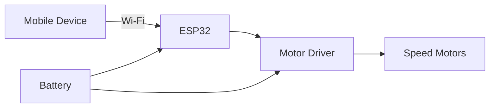

# 🛞 ESP32 Three-Wheel Wi-Fi Rover


A three-wheel rover controlled over Wi-Fi from a mobile device. The ESP32 drives the motors through a motor driver and manages battery power.


## ✨ Features

- Three-wheel chassis with speed motors and a motor driver
- Wi-Fi remote control from a mobile device for smooth movement and navigation
- Motor control and battery power management on the rover

## 🧩 System Overview



## 🔧 Hardware

| Component | Purpose |
| :-------- | :------ |
| ESP32 | Main controller, Wi-Fi |
| Motor driver | Drives the motors |
| Speed motors | Wheel drive |
| Chassis (3 wheels) | Rover body |
| Battery | Power supply |

## 🔌 Pin Connections

| Motor Driver Pin | ESP32 Pin | Function |
| :--------------- | :-------- | :------- |
| IN1 | GPIO 26 | Left motor direction |
| IN2 | GPIO 27 | Left motor direction |
| IN3 | GPIO 14 | Right motor direction |
| IN4 | GPIO 12 | Right motor direction |
| ENA | GPIO 25 | Left motor speed (PWM) |
| ENB | GPIO 33 | Right motor speed (PWM) |

> Pin numbers above are for the reference code. Change them in `wifi_rover.ino` if your wiring is different.

## 🚀 How to Use

1. Upload `code/wifi_rover.ino` to the ESP32 using Arduino IDE.
2. Power the rover from the battery.
3. On your phone, connect to the Wi-Fi hotspot **ESP32-Rover** (password: `rover1234`).
4. Open **http://192.168.4.1** in the phone browser.
5. Hold the arrow buttons to move; release to stop. Use the slider to change speed.

## 🛡️ Safety

The rover stops automatically if it does not receive a command for 600 ms (for example, if the phone disconnects).

## 💻 About the Code

`code/wifi_rover.ino` is a reference implementation of the rover control logic: the ESP32 runs a Wi-Fi hotspot and a small web server, and drives the motors through PWM.

## 📸 Photos

| Circuit | Demo |
| :-----: | :--: |
|  |  |

## 📁 Repository Structure

```text
├── code/        # Arduino sketch (.ino)
├── images/      # prototype and circuit photos
└── README.md
```

## 👤 Author

**Mareeshwaran S**, ECE student · [GitHub](https://github.com/Mareeshwaran606) · mareesh606@gmail.com
